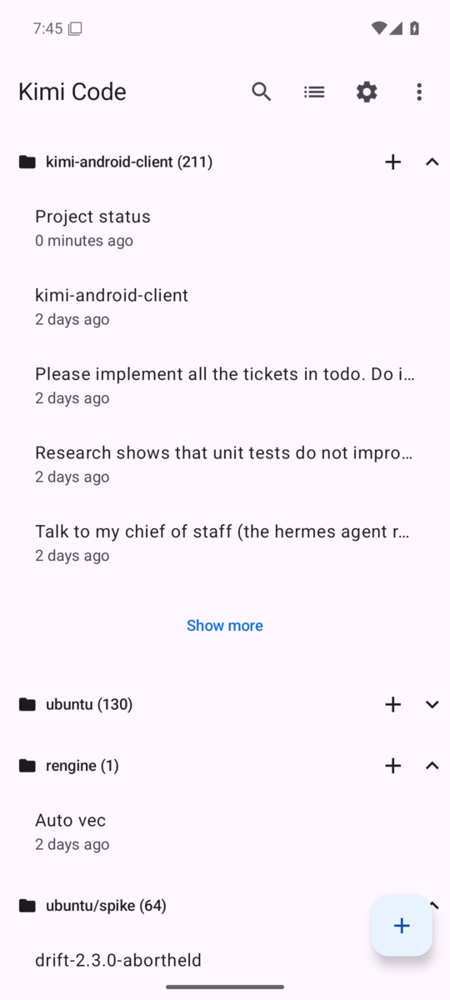
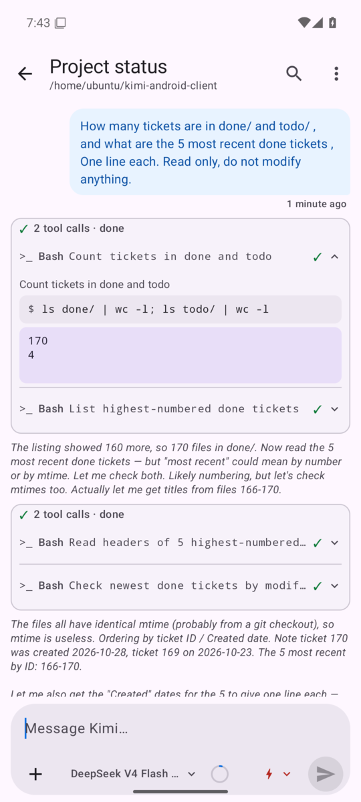
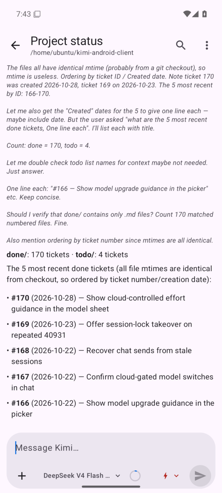

# Kimi Android Client

A native Android client for [Kimi Code](https://github.com/MoonshotAI/kimi-code),
the open-source coding agent: drive the agent from your phone with a native UI
instead of the browser.

The app talks to the same backend as the Kimi Code web client — the HTTP +
WebSocket server embedded in the `kimi` binary — and always tracks the latest
server release. It has been in daily use since July 2026.

<p align="center">
  
  
  
</p>

## Features

- **Sessions** — list grouped by workspace with live status (running spinner,
  unread dot, pending-approval badge); create a session in any workspace;
  fork, archive or delete; offline cache of the list.
- **Chat** — live streaming with Markdown rendering; rich tool-call rows: bash
  with live output, file edits as diffs, file reads and writes, grep and glob
  results, web search and fetch; per-turn file changes with a before/after
  viewer; file and image attachments; message search, in a session or across
  all of them.
- **Steering the agent** — approve permission requests, answer the agent's
  questions (multi-select included), steer or stop a running turn, pick the
  model and thinking effort per session, switch permission modes, compact the
  context from the context-usage ring.
- **Sub-agents and background work** — sub-agent pages with live transcripts,
  agent-swarm roster with aggregate progress, background job screens, the
  agent's todo list.

## How it is built

The app is developed agent-first. A coding agent (Kimi Code, running headless
on a VPS) writes the code; the human side is product direction, the guardrails
in this repository, and trying every build on a real phone.

- **Tickets.** Every change starts as a small ticket in [`todo/`](todo/) with
  acceptance criteria, and moves to [`done/`](done/) with implementation notes
  once it ships — 170 so far.
- **Agent instructions.** [`AGENTS.md`](AGENTS.md) and
  [`docs/conventions.md`](docs/conventions.md) hold the project rules: latest
  server only, no compatibility shims, where the protocol ground truth lives.
- **Protocol drift automation.** Every night a timer installs the newest Kimi
  Code server. If it comes up unhealthy, a headless agent repairs the service;
  then another agent reads the upstream changelog, re-verifies the wire
  protocol, rewrites [`docs/server-api.md`](docs/server-api.md), and files
  tickets for what broke and for new server capabilities the app could use
  ([`docs/server-drift.md`](docs/server-drift.md)).
- **Tests.** About 1,000 JVM unit tests (the data layer runs against
  MockWebServer) and about 230 Compose UI tests, run on a dedicated emulator
  runner through [`scripts/run-e2e.sh`](scripts/run-e2e.sh).
- **Crash loop.** The maintainer's builds report to Firebase Crashlytics; a
  crash becomes a ticket, and its Crashlytics issue is closed from the command
  line once the fix has shipped ([`docs/crashlytics.md`](docs/crashlytics.md)).

## Stack

Kotlin 2.4 · Jetpack Compose (Material 3) · Hilt · coroutines and Flow ·
OkHttp 5 (HTTP and WebSocket) · kotlinx.serialization · DataStore · Navigation
Compose with type-safe routes · Android Gradle Plugin 9.

## Build and run

Requirements: JDK 21 and the Android SDK (compile SDK 37). The app runs on
Android 16 and newer.

```bash
./gradlew :app:assembleDebug
adb install app/build/outputs/apk/debug/app-debug.apk
```

In the app settings, enter the URL of your Kimi Code web server and its bearer
token (`~/.kimi-code/server.token` on the server machine; rotate it with
`kimi web rotate-token`). The phone must reach the server, for example over
Tailscale; plain HTTP is allowed because traffic stays inside the tailnet.

Crash reporting is optional: put your own `google-services.json` in `app/` to
build with Firebase Crashlytics.

## License

[MIT](LICENSE)
